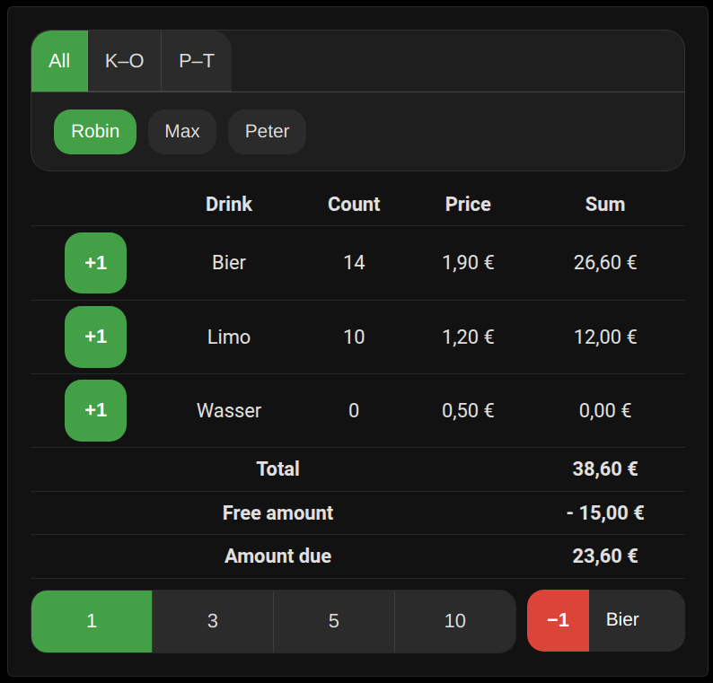

# Tally List Integration

🇩🇪 [Deutsche Version lesen](README.de.md)

This custom integration for [Home Assistant](https://www.home-assistant.io/) is distributed via HACS and helps you manage drink tallies for multiple persons. All persons with a linked Home Assistant user account are imported automatically. Drinks are defined once and shared across everyone.

## Features 

- Automatic import of persons with user accounts.
- Bundled dashboard cards (Tally List, ranking, free drinks, PIN) — no separate card installation.
- Shared drink list with name and price for every person.
- Sensor entities for drink counts, drink prices, a free amount, a personal credit balance, and the total amount due per person.
- Button entity to reset a person's counters; only users with override permissions ("Tally Admins") can use it.
- Configurable currency symbol (defaults to €).
- Services to add, remove, adjust, reset and export tallies, and manage personal PINs (Tally Admins can set PINs for other users).
- Counters cannot go below zero when removing drinks.
- Option to exclude persons from automatic import.
- Grant override permissions to selected users so they can tally drinks for everyone.
- Public devices can tally drinks for everyone when the target user's PIN is provided.
- Optional free drinks mode with a dedicated user, log feed sensors and configurable name.

## Installation

1. Add this repository to HACS as a custom repository.
2. Install the **Tally List** integration.
3. Restart Home Assistant and add the integration via the integrations page.

The Lovelace dashboard cards are bundled with the integration — no separate card installation is needed. After restarting, the card file is served from `/tally_list/tally-list-card.js` and is registered automatically as a Lovelace resource, so the cards appear in the card picker right away.

### Migrating from the separate card repository

If you previously installed the card from the separate `ha-tally-list-lovelace` repository:

1. Update this integration and restart Home Assistant.
2. In HACS, remove the **Tally List Card** (Lovelace) repository.
3. Under **Settings → Dashboards → Resources**, delete the old `/hacsfiles/...` resource.

The new resource is created automatically and existing dashboard cards keep working.

### YAML mode

If your dashboards are stored in YAML, add the resource manually:

```yaml
lovelace:
  resources:
    - url: /tally_list/tally-list-card.js
      type: module
```

## Dashboard Cards

The integration ships the following cards (element names are unchanged, so existing dashboards keep working):

### Tally List Card

A Lovelace card that displays drink tallies per user and allows updating them. Selecting a name shows drink counts and the amount owed. Prices and users are read automatically from the integration. Currency and language follow Home Assistant settings (English and German supported, with optional override).



```yaml
type: custom:tally-list-card
```

All users detected by the integration appear in the selector. By default this is a dropdown list, but admins (as defined in the integration) may switch to tabs or a grid of chips via the `user_selector` option. Regular users only see their own name and cannot change it. Drink prices are taken from sensors named `sensor.price_list_<drink>_price`. If `sensor.price_list_free_amount` exists, its value is deducted from each user's total. Sensors named `sensor.<name>_amount_due` override the calculated amount due.

Below the user selection a row of buttons lets you choose how many drinks to add or remove at once (1, 3, 5, or 10). The highlighted value is used for all subsequent actions.

Pressing **+X** adds the selected number of drinks:

```yaml
action: tally_list.add_drink
data:
  user: Robin
  drink: Wasser
  count: 3
```

The **Remove drink** button subtracts drinks with a `tally_list.remove_drink` call. If `count` is omitted, both services default to `1`.

Options (in the UI):

* **Lock time (ms)** – Duration the buttons stay disabled after pressing them. Default `400`.
* **Session timeout (s)** – Time after login before automatic logout. Default `30`.
* **Maximum width (px)** – Limit card width. Default `500`.
* **Show remove menu** – Enable/disable the remove-drink dropdown.
* **Show step selection** – Show buttons to select the step size (1, 3, 5, 10).
* **Only show self** – Limit selection to the logged‑in user even for admins.
* **Shorten user names** – Abbreviate names in the selector while keeping them unique.
* **User selector** – Choose between **list**, **tabs**, or **grid** for selecting users.
* **Language** – Force **Auto**, **Deutsch**, or **English**.
* **Version** – Display the installed version.

### Amount Due Ranking Card

A card that lists all users ordered by outstanding amount.

```yaml
type: custom:tally-due-ranking-card
```

Options:

* **Maximum width (px)** – Limit card width.
* **sort_by** – `due_desc` (default), `due_asc`, or `name`.
* **sort_menu** – Show a dropdown to change the sort order.
* **show_reset** – Show the admin reset button.
* **show_total** – Display the total outstanding amount.
* **max_entries** – Limit how many users are shown (`0` = no limit).
* **hide_free** – Hide users who owe nothing.
* **show_copy** – Show the "Copy table" button.
* **shorten_user_names** – Abbreviate user names in the table.

### Free Drinks Card

Book free drinks with a mandatory comment. Counts are kept locally until submitted. Use the reset button to clear all counts. A user must be selected before entering the PIN.

```yaml
type: custom:tally-list-free-drinks-card
```

Options:

* **show_prices** – Display drink prices (`true` by default).
* **comment_presets** – Predefine comment prefixes. Each entry has a `label` and optional `require_comment`.
* **session_timeout_seconds** – Time after login before automatic logout (`30` by default).
* **pin_lock_ms** – PIN lock duration in milliseconds (`5000` by default).
* **free_drinks_timer_seconds** – Auto-reset timer in seconds (`0` to disable).
* **free_drinks_per_item_limit** – Maximum free drinks per item (`0` to disable).
* **free_drinks_total_limit** – Maximum free drinks overall (`0` to disable).
* **shorten_user_names** – Abbreviate user names in the selector.

Example:

```yaml
type: custom:tally-list-free-drinks-card
comment_presets:
  - label: Einsatz
    require_comment: true
  - label: Übung
    require_comment: false
```

### PIN Set Card

Allow users to set or reset their 4-digit PIN. Administrators can select any user and update the PIN for them. The card is available in the Lovelace card picker. When opened, a configurable warning can remind users not to use important PINs such as their bank card PIN. Leave the warning text empty to disable it.

```yaml
type: custom:tally-set-pin-card
```

The card uses the same user list as the main Tally List card and normally requires no additional configuration.

Options:

* **lock_ms** – Lock duration in milliseconds after each PIN attempt (`5000` by default).
* **user_selector** – User selection layout: `list`, `tabs`, or `grid` (`list` by default).
* **shorten_user_names** – Abbreviate user names in the selector.
* **pin_warning** – Warning text shown when opening the card. Supports line breaks and simple Markdown for _italic_, **bold**, and __underline__. Set to an empty string to hide the warning.

It calls the `tally_list.set_pin` service to store the new code, e.g.:

```yaml
action: tally_list.set_pin
data:
  user: Erika Mustermann
  pin: "1234"
```

## Usage

At initial setup you will be asked to enter available drinks. All persons with a user account share this list. Drinks and prices can later be managed from the integration options.

### Services

- `tally_list.add_drink`: increment drink count for a person (fails if the person does not exist; optionally specify amount).
- `tally_list.remove_drink`: decrement drink count for a person (never below zero; optionally specify amount).
- `tally_list.set_drink`: set a drink count to a specific value.
- `tally_list.reset_counters`: reset all counters for a person or for everyone if no user is specified.
- `tally_list.export_csv`: export all `_amount_due` sensors to CSV files (`daily`, `weekly`, `monthly`, or `manual`) saved under `/config/tally_list/<type>/`.
- `tally_list.set_pin`: set or clear a personal 4-digit numeric PIN required for public devices (admins can set PINs for others).
- `tally_list.add_credit`: increase credit for a person.
- `tally_list.remove_credit`: decrease credit for a person.
- `tally_list.set_credit`: set credit for a person to an exact amount.

### Reset Button

Each person gets a `button.<person>_reset_tally` entity to reset all their counters. Only Tally Admins can press it.

### Credit

Every person also has a `sensor.<person>_credit` entity that stores their available credit. Positive credit reduces the `*_amount_due` sensor; negative credit increases it. Adjust credit through the `tally_list.add_credit`, `tally_list.remove_credit`, and `tally_list.set_credit` services.

## Price List and Sensors

All drinks are stored in a single price list. A dedicated user named `Preisliste` (`Price list` in English) exposes one price sensor per drink as well as a free amount sensor, while regular persons get count, credit and total amount sensors. The free amount and personal credit are subtracted from each person's total. You can edit drinks, prices and the free amount at any time from the integration options.
Sensors for the price list user always use English entity IDs prefixed with `price_list`, for example `sensor.price_list_free_amount` or `sensor.price_list_wasser_price`.

Every change to the price list is written to yearly CSV logs under `/config/tally_list/price_list/`. A feed sensor `sensor.price_list_feed` shows the latest entry and exposes recent changes in its attributes.

## Free Drinks (Optional)

If enabled in the integration options, complimentary drinks are tracked separately.
A dedicated user (default name `Free Drinks`, configurable) records all free
drinks and exposes the same count and amount sensors as regular users, for
example `sensor.free_drinks_beer_count` and `sensor.free_drinks_amount_due`.
Each free drink entry is written to yearly CSV files `free_drinks_<year>.csv`
under `/config/tally_list/free_drinks/`. A feed sensor
`sensor.free_drink_feed` shows the latest log entry and lists recent free drinks
in its attributes.

You can activate or deactivate the feature and change the free drinks user name
from the integration options.

## WebSocket API

The WebSocket command `tally_list/get_admins` returns all users that currently have override permissions and can be called from the Home Assistant frontend or an external client. The command requires an authenticated Home Assistant user.

```js
await this.hass.callWS({ type: "tally_list/get_admins" });
```

Example response:

```json
{"admins":["tablet_dashboard","Test","Test 2"]}
```

The command `tally_list/is_public_device` returns whether the authenticated user is configured as a public device:

```js
await this.hass.callWS({ type: "tally_list/is_public_device" });
```

Example response if the user is configured as a public device:

```json
{"is_public": true}
```

Example response for a regular user:

```json
{"is_public": false}
```

Public devices can authenticate a user once via the `tally_list/login` command so that subsequent service calls no longer need the `pin` parameter:

```js
await this.hass.callWS({ type: "tally_list/login", user: "Alice", pin: "1234" });
```

Example success response:

```json
{"success": true}
```

To end the session call `tally_list/logout`:

```js
await this.hass.callWS({ type: "tally_list/logout" });
```
